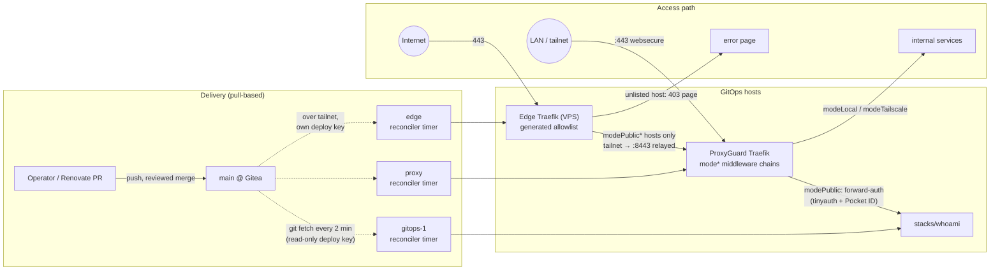

# homelab-gitops-showcase

A pull-based GitOps and DevSecOps setup for a small self-hosted fleet: Ansible
provisions and hardens the hosts, a systemd reconciler on each host converges its
Docker stacks to `main`, SOPS keeps secrets encrypted in git, and a two-tier Traefik
design makes accidental internet exposure take two independent mistakes.

> **This is a sanitized mirror of a running system.** Structure, code and decisions are
> real. Hostnames, addresses, domains, keys and inventory are replaced with examples
> (`example.com`, RFC 5737 ranges, fake age recipients). No ciphertext from the real
> repository is included: secrets appear only as `*.example` shape files.

## Architecture



## Repository map

| Path | What |
| --- | --- |
| `inventories/example/` | Six-host example inventory, group/host vars, vault shape files |
| `playbooks/` | `site.yaml` composition root, `lifecycle/` (provision, bootstrap, update), `services/` |
| `roles/` | Hardening (`user`, `harden_ssh`, `ufw`, `fail2ban`, `unattended_upgrades`), `gitops`, `relay_guard`, `docker_socket_proxy`, `renovate`, `gitea_runner`, `docker_prune` |
| `stacks/` | Docker Compose stacks the reconciler converges: `edge`, `proxyguard`, `whoami` |
| `scripts/hooks/` | Repository-specific policy checks run by prek |
| `docs/adr/` | Architecture decisions: access model, validation contract, DNS as code |
| `docs/ref/` | Reference for the reconciler, Renovate and the CI runner |
| `CONTEXT.md` | Glossary of the domain terms used everywhere else |

## GitOps

Each host in `[gitops]` runs `gitops-reconcile.timer` (`roles/gitops`). Every tick is a plain
shell script: no Ansible, no agent, no inbound port. The invariants:

- **Convergence.** `git fetch` then `git reset --hard origin/main`: tracked files on the host
  *are* `main`, so a hand edit is reverted on the next tick. It never runs `git clean`, so
  untracked runtime state and decrypted secrets survive.
- **Kill switch.** `/etc/homelab-gitops.disabled` freezes one host without touching the others;
  a `flock` prevents overlapping runs.
- **Skip-gate.** A stack that ships `.env.example` but has no `.env` yet is *skipped*, not
  failed, so a host can be assigned a stack before its secret exists.
- **Teardown never uses `-v`.** A stack removed from a host's `gitops_stacks` is
  `docker compose down --remove-orphans`; named volumes and `/srv/<stack>` data stay, and the
  decrypted `.env` is scrubbed.
- **Per-stack failure isolation.** A failed decrypt or `compose up` marks the tick failed but
  never stops the other stacks from converging.
- **Storage split.** Config is git-owned and mounted `:ro`; runtime state lives under
  `/srv/<stack>/`, outside the checkout.

Deploying a change is merging to `main`. Image updates arrive as Renovate pull requests, so
every version change is a reviewed diff. Details: [`docs/ref/gitops.md`](docs/ref/gitops.md).

## Secrets

- **Stack secrets:** SOPS + age. `stacks/<s>/.env` is encrypted to `stacks/<s>/.env.sops`
  (`just encrypt-envs`) using the recipients in [`.sops.yaml`](.sops.yaml), committed, and
  decrypted to `.env` on the host each tick with an age identity Ansible installed.
  The internet-facing edge has its **own** age key and deploy key, so compromising it exposes
  only the edge's own secret.
- **Host secrets:** ansible-vault (`vault.yaml` per group or host). This mirror contains only
  `vault.example.yaml` shape files.
- Plaintext never enters git: `.gitignore` excludes `.env*` except `*.example` and `.env.sops`,
  and the `assert-encrypted` hook rejects a `vault.yaml` or `.env.sops` that is not ciphertext.

## Security controls

| Control | Enforced where | Prevents |
| --- | --- | --- |
| Key-only SSH, no root login, `AllowUsers`, `sshd -t` validation | `roles/harden_ssh` | Password brute force; a bad config locking the fleet out |
| Default-deny host firewall, rules rebuilt each run | `roles/ufw` | Stale or hand-added open ports surviving |
| fail2ban on sshd | `roles/fail2ban` | Credential stuffing over SSH |
| Security-only unattended upgrades, no auto-reboot on the hypervisor | `roles/unattended_upgrades`, `group_vars/proxmox` | Unpatched CVEs; unplanned hypervisor reboots |
| Pinned, checksum-verified binaries (sops, runner) | `roles/gitops`, `roles/gitea_runner` | Tampered or drifting downloads |
| Read-only deploy keys; Gitea host key pinned in `known_hosts` | `roles/gitops` | Hosts pushing to git; trust-on-first-use spoofing of the git server |
| SOPS + age, per-tier recipients | `.sops.yaml`, `roles/gitops` | Plaintext secrets in git; one host compromise decrypting every secret |
| `assert-encrypted`, `sops-recipients`, `gitleaks` hooks | `prek.toml` | Committing plaintext; ciphertext sealed to the wrong keys; leaked tokens |
| Every router declares one `mode*` and explicit entrypoints | `scripts/hooks/check-traefik-modes.py` | A router silently binding the internet-facing entrypoint |
| Edge relays only a generated allowlist; everything else gets a 403 page | `scripts/hooks/generate-edge-config.py`, `stacks/edge` | Blind relaying of every hostname inward |
| Mandatory forward-auth on `modePublic` | `stacks/proxyguard/.../_common.yaml` | Unauthenticated internet access to internal apps |
| nftables relay guard: edge may reach only :8443, only the edge may reach :8443 | `roles/relay_guard` | A compromised edge reaching tailnet-only services (Tailscale bypasses UFW) |
| Non-public routers must resolve to private or tailnet addresses | `scripts/hooks/check-dns-records.py` | Publishing an internal name to the internet |
| Docker API through a read-only socket proxy | `roles/docker_socket_proxy` | Monitoring agents holding docker-group root |
| Traefik file provider only, no Docker socket | `stacks/*/traefik` | A container label publishing a route |
| Renovate opens PRs, never automerges; CI runner has no socket, no privileged jobs | `roles/renovate`, `roles/gitea_runner` | Unreviewed dependency changes; CI jobs escaping to the host |

## Validation

One contract in [`prek.toml`](prek.toml) with three groups ([ADR 0007](docs/adr/0007-use-one-three-group-prek-contract.md)):
`format` (idempotent rewriters), `check` (fast file-local verdicts), and `verify` (every check
plus whole-repository verdicts such as `ansible-lint`, the edge allowlist drift check, and the
chore audit). CI runs the same contract ([`.github/workflows/validate.yaml`](.github/workflows/validate.yaml)).

### Validate locally

Requires [prek](https://github.com/j178/prek), [uv](https://docs.astral.sh/uv/) and
[just](https://just.systems/).

```sh
just install                                   # Ansible via mise, Galaxy deps, git hooks
prek run --all-files                           # format + fast checks
prek run --all-files --hook-stage manual       # every gate, including verify
```

## Run it

```sh
just play site                                 # the whole fleet
just play services/gitops --limit gitops-1     # (re)deploy one reconciler and reconcile now
just gitops-logs edge                          # reconcile journal from one host
```
